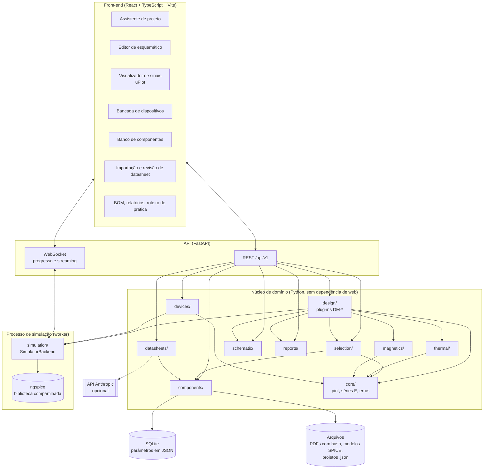

# Arquitetura

> Status: **rascunho da Fase 0, aguardando aprovação do usuário.**
> Parte da arquitetura de referência do prompt (seção 6). Os ajustes propostos estão marcados com **[ajuste]** e justificados.

## 1. Visão geral

Aplicação **local-first**: um back-end Python (FastAPI) roda no computador do usuário e serve uma interface React no navegador. Uso individual (decisões D2 e D3): banco SQLite local, sem contas de usuário. O acesso a dados passa pelo SQLAlchemy, o que mantém o PostgreSQL possível no futuro.



## 2. Camadas e regras de dependência

1. **`core/`** não depende de nada do projeto.
2. **Núcleo de domínio** (`design/`, `selection/`, `thermal/`, `magnetics/`, `devices/`, `schematic/`, `reports/`, `components/`, `datasheets/`) não importa FastAPI. Pode ser usado em scripts, notebooks e testes sem servidor. Isso permite ao professor usar o núcleo diretamente em Jupyter para preparar aulas.
3. **`api/`** apenas traduz HTTP/WebSocket ↔ chamadas de domínio e serializa grandezas.
4. **`simulation/`** roda em **processo separado** (ver seção 5).
5. Dependências verificadas na CI com `import-linter`.

## 3. Grandezas e unidades

- Dentro do núcleo, toda grandeza é `pint.Quantity` (escalar ou vetor NumPy), com um único `UnitRegistry` em `core/units.py`.
- Na fronteira da API, grandezas são serializadas como `{"value": 1.2e-3, "unit": "A"}` (vetores: `{"values": [...], "unit": "V"}`). Nunca número nu.
- Laços numéricos intensivos (FFT, integração, ajuste de curvas) podem operar sobre magnitudes, **somente** dentro de funções marcadas com o decorador `@magnitudes(...)` que converte na entrada e reanexa unidades na saída. Isso mantém a regra 2 sem custo de desempenho do `pint` em arrays grandes.
- Front-end formata com notação de engenharia (k, M, m, µ, n, p) e vírgula decimal (pt-BR).

## 4. Plug-ins de projeto (`DesignModule`)

Cada topologia é um pacote em `design/plugins/<id>/` registrado por *entry point* (`circuitos.design_modules`). Novas topologias não alteram o núcleo.

```python
class DesignModule(Protocol):
    id: str                       # "DM-RET1.ponte"
    family: str                   # "retificadores"
    spec_schema: type[BaseModel]  # especificações + carga + contorno

    def compute_stresses(self, spec) -> StressReport: ...          # passo 1: ideal
    def select(self, spec, stresses, db, policy) -> Selection: ...  # usa selection/
    def recompute(self, spec, components) -> DesignResult: ...      # passo 2: real, iterativo
    def build_circuit(self, spec, result) -> Circuit: ...           # modelo interno → netlist
    def schematic_template(self) -> SchematicTemplate: ...          # layout legível fixo
    def operating_limits(self, spec, result, sweep) -> LimitsReport: ...
    def report(self, spec, result) -> ReportSections: ...
    def lab_guide(self, spec, result) -> LabGuide: ...              # roteiro de prática
```

**Cálculo em dois passos** (prompt, seção 7): `recompute` itera até convergência (critério relativo configurável, padrão 0,1 %, máx. 50 iterações) entre perdas → razão cíclica/ângulo → correntes → Tj → parâmetros dependentes de Tj. Não convergir gera erro explícito, nunca resultado silencioso.

**Memória de cálculo:** toda função de cálculo retorna `Calculated[T]` = valor + `CalcStep` (equação em LaTeX, entradas com unidades, premissas, referência bibliográfica com livro/edição/capítulo/equação). O relatório e o modo didático são gerados desses passos, não reescritos à mão.

## 5. Simulação

- **[ajuste] Interface própria para o ngspice em modo biblioteca compartilhada** (`ctypes` sobre `libngspice`), em vez de PySpice. Motivo: PySpice tem manutenção irregular e acompanha mal as versões novas do ngspice; a API do `sharedspice.h` é pequena e estável. Um *fallback* em modo batch (`ngspice -b`, leitura de *rawfile*) cobre plataformas onde a biblioteca não carrega.
- `SimulatorBackend` abstrato; `NgspiceBackend` é a primeira implementação. Xyce pode entrar depois sem mudar chamadores.
- Cada simulação roda em **processo worker** (`multiprocessing`/`concurrent.futures` com *spawn*), porque o ngspice não é reentrante e um travamento não pode derrubar a API. Progresso e cancelamento por WebSocket.
- **[ajuste]** Para uso local não há Celery/Redis; uma fila em processo basta. A interface `JobQueue` permite trocar por RQ/Redis se um dia houver uso multiusuário.
- Falhas de convergência são classificadas (timestep too small, singular matrix, gmin stepping failed) e traduzidas em mensagens com sugestões (`RELTOL`, `GMIN`, `.IC`, passo máximo, modelo ideal da chave).
- Pós-processamento em `simulation/post/`: média, RMS, FFT com janela e detecção de período, THD, regime permanente, potência instantânea e média por componente.

## 6. Esquemáticos

- **[ajuste] Esquemático automático por gabarito**, não por posicionamento genérico: cada plug-in fornece um `SchematicTemplate` (posições e rotas ortogonais parametrizadas). Topologias de eletrônica de potência têm convenção visual consagrada, e auto-layout genérico produz desenhos ruins para aula. Auto-layout fica para circuitos do simulador livre.
- Renderização SVG própria, com bibliotecas de símbolos **IEC 60617** e **ANSI/IEEE 315** selecionáveis. `schemdraw` é avaliado como opção para relatórios estáticos.
- Editor livre (Fase 7): implementação própria sobre SVG com grade e roteamento ortogonal. **[ajuste]** React Flow e JointJS são orientados a grafos e diagramas de blocos e lidam mal com pinos, fios com junções e rotação de símbolos; avaliaremos um protótipo de cada na Fase 7 antes de decidir em definitivo.

## 7. Visualização de sinais

- **uPlot** para todo traço no domínio do tempo (milhões de pontos, cursores, zoom); decimação min/max no back-end antes de enviar.
- Bode, espectro, XY e curvas características também em uPlot, com componentes próprios para eixos log e fase. Plotly só se surgir necessidade (ex.: 3D).
- Exportação de figuras para publicação: geradas no **back-end com Matplotlib** (SVG/PDF/PNG, fundo branco), para qualidade igual em todas as plataformas.
- Equações com **KaTeX**.

## 8. Banco de dados e armazenamento

- SQLAlchemy 2 + Alembic sobre SQLite (D3). Sem código específico de SQLite fora da camada de repositório, para permitir PostgreSQL no futuro.
- Parâmetros por categoria em JSON validado por esquemas Pydantic versionados (ver `modelo-de-dados.md`).
- Arquivos (PDFs, modelos SPICE, imagens de curvas) em diretório de dados, endereçados por SHA-256.
- Banco inicial de componentes versionado no repositório como **arquivos YAML revisáveis** (`data/components/<categoria>/<part>.yaml`) e importado para o banco. Assim, cada parâmetro e sua fonte passam por revisão em *pull request*.

## 9. Relatórios

- Geração HTML com Jinja2 + KaTeX; PDF via **WeasyPrint** (dispensa LaTeX instalado).
- BOM em CSV/XLSX (`openpyxl`)/PDF.
- Roteiro de prática como seção do relatório e como documento separado.

## 10. Importação de datasheets

- `PyMuPDF` para texto e imagens; `pdfplumber` para tabelas; OCR com Tesseract quando a página não tem texto.
- LLM **opcional**: API da Anthropic com saída estruturada validada pelo esquema Pydantic da categoria. Sem chave configurada, o fluxo funciona manualmente (o usuário preenche com o PDF ao lado).
- Cada parâmetro extraído guarda página, trecho e caixa delimitadora de origem. Nada entra em seleção automática antes da revisão humana.

## 11. Empacotamento

- Desenvolvimento: Docker Compose (back-end e front-end).
- **[ajuste]** Distribuição para professores e alunos: back-end empacotado com PyInstaller, levando ngspice e a interface compilada, abrindo no navegador padrão. Tauri como invólucro desktop fica como avaliação na Fase 9, depois que o produto estabilizar. Motivo: reduz a superfície de empacotamento enquanto a interface muda muito.

## 12. Qualidade

- Python: `ruff` (lint e formatação), `mypy --strict` no núcleo, `pytest`, `hypothesis`, cobertura ≥ 80 % no núcleo de cálculo.
- TypeScript: `strict`, ESLint, Prettier, Vitest, Playwright nos fluxos principais.
- Verificações (decisão D1: sem GitHub; script local `scripts/check.sh`, adaptável a CI depois): lint, tipos, testes unitários, testes com ngspice em Linux e Windows, `import-linter`.

## 13. Estrutura do repositório

```
sistema-circuitos/
├── backend/
│   ├── src/circuitos/
│   │   ├── core/ components/ selection/ thermal/ magnetics/
│   │   ├── devices/ design/{base.py,plugins/} simulation/{backend,post}/
│   │   ├── schematic/ reports/{lab}/ datasheets/ api/
│   └── tests/{unit,golden,analytic_vs_sim,datasheet,property}/
├── frontend/src/{features,components,lib}/
├── data/components/<categoria>/*.yaml   # banco inicial revisável
├── data/heatsinks/ data/cores/ data/wires/
├── docs/{escopo,arquitetura,modelo-de-dados,roadmap}.md, docs/validacao/
├── docker-compose.yml
└── CLAUDE.md
```
