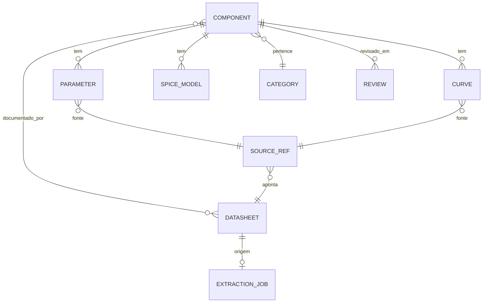

# Modelo de dados e contratos

> Status: **rascunho da Fase 0, aguardando aprovação do usuário.**
> Os exemplos abaixo usam `null` e `<do datasheet>` de propósito: nenhum valor de componente é preenchido de memória (regra 1).

## 1. Grandeza com unidade

```python
class Quantity(BaseModel):          # serialização na fronteira; no núcleo é pint.Quantity
    value: float
    unit: str                       # validado contra o UnitRegistry (ex.: "V", "mA", "°C/W")
```

## 2. Componentes

### 2.1 Entidades



### 2.2 `ComponentRecord`

```python
class ComponentRecord(BaseModel):
    id: UUID
    category: CategoryId            # "diode.rectifier", "mosfet.si", "capacitor.electrolytic", ...
    schema_version: str             # versão do esquema de parâmetros da categoria
    manufacturer: str
    part_number: str
    package: str | None             # "DO-41", "TO-220AB"
    lifecycle: Literal["ativo", "nrnd", "obsoleto", "desconhecido"]
    parameters: dict[str, Parameter]    # chaves definidas pelo esquema da categoria
    curves: list[Curve]
    thermal: ThermalParams | None
    spice_models: list[SpiceModelRef]
    datasheets: list[DatasheetRef]
    review: ReviewState
    tags: list[str]
```

### 2.3 `Parameter`

```python
class Parameter(BaseModel):
    symbol: str                     # "VRRM", "IF(AV)", "RDS(on)"
    min: float | None
    typ: float | None
    max: float | None
    unit: str                       # obrigatório
    conditions: dict[str, Quantity] # {"Tj": 25 °C, "VGS": 10 V, "ID": ...}
    source: SourceRef | None        # obrigatório para status "revisado"
    status: Literal["a_verificar", "extraido", "revisado"]
    note: str | None
```

Regras de validação:
- ao menos um de `min`/`typ`/`max` preenchido, ou o parâmetro inteiro ausente;
- `status = "revisado"` exige `source` com página;
- um componente só tem `review.status = "liberado"` se **todos os parâmetros obrigatórios** da categoria estiverem `revisado`. Só componentes liberados entram na seleção automática.

### 2.4 Rastreabilidade

```python
class DatasheetRef(BaseModel):
    id: UUID
    manufacturer: str
    document_number: str | None
    revision: str | None
    date: date | None
    url: HttpUrl | None
    sha256: str | None              # do PDF armazenado
    retrieved_at: datetime

class SourceRef(BaseModel):
    datasheet_id: UUID
    page: int
    location: str | None            # "Table 1 — Absolute Maximum Ratings", "Fig. 3"
    excerpt: str | None             # trecho literal
    bbox: tuple[float, float, float, float] | None   # para destacar no visor de PDF

class ReviewState(BaseModel):
    status: Literal["rascunho", "em_revisao", "liberado", "rejeitado"]
    reviewed_by: str | None
    reviewed_at: datetime | None
    created_by: str
    created_at: datetime
```

### 2.5 Curvas digitalizadas

```python
class Curve(BaseModel):
    name: str                       # "IF x VF", "RDS(on) normalizado x Tj"
    x: AxisSpec                     # grandeza, unidade, escala "lin" | "log"
    y: AxisSpec
    family: dict[str, Quantity] | None   # parâmetro da família (ex.: Tj = 125 °C)
    points: list[tuple[float, float]]
    source: SourceRef
    digitized_by: str
```

### 2.6 Esquema por categoria (exemplo: diodo retificador)

```yaml
category: diode.rectifier
schema_version: "1.0"
required:      [VRRM, IF(AV), IFSM, VF, IR, Tj_max]
optional:      [VRSM, I2t, trr, Qrr, Cj, Rth_ja, Rth_jl, Rth_jc]
parameters:
  VRRM:   {unit: V,   kind: max_rating}
  IF(AV): {unit: A,   kind: max_rating, conditions_required: [T_ref]}
  IFSM:   {unit: A,   kind: max_rating, conditions_required: [t_pulse]}
  VF:     {unit: V,   kind: characteristic, conditions_required: [IF, Tj]}
  trr:    {unit: s,   kind: characteristic, conditions_required: [IF, IR_rec, Tj]}
```

Exemplo de registro (YAML do banco inicial, ainda não preenchido):

```yaml
manufacturer: <fabricante>
part_number: 1N4007
category: diode.rectifier
package: DO-41
datasheets:
  - {id: ds1, manufacturer: <fabricante>, document_number: <do datasheet>, revision: <do datasheet>, url: <do datasheet>}
parameters:
  VRRM:
    max: null
    unit: V
    status: a_verificar
    source: {datasheet_id: ds1, page: null, location: null}
```

Categorias previstas: as listadas na seção 4.6 do prompt, cada uma com seu esquema em `backend/src/circuitos/components/schemas/<categoria>.yaml`.

### 2.7 Catálogos auxiliares

- `Heatsink`: fabricante, perfil, comprimento, Rθsa (convecção natural e, se houver, curva × velocidade do ar), fonte.
- `MagneticCore`: fabricante, forma (EE, ETD, PQ, toroide…), material, Ae, le, Ve, Aw, AL, Bsat(T), coeficientes de Steinmetz por frequência, fonte.
- `Wire`: AWG/mm, diâmetro com isolação, resistência por metro a 20 °C, fonte (norma ou catálogo).

## 3. Projetos

```python
class Project(BaseModel):          # arquivo .json aberto e versionável
    format_version: str
    id: UUID
    name: str
    module_id: str                  # "DM-RET1.ponte"
    spec: dict                      # validado pelo spec_schema do módulo
    derating_policy: DeratingPolicy
    locked_components: dict[str, UUID]       # designador → componente travado
    result: DesignResult | None
    circuit: Circuit | None
    history: list[ProjectRevision]

class DeratingPolicy(BaseModel):
    by_category: dict[CategoryId, dict[str, float]]   # {"diode.rectifier": {"VRRM": 1.5, "IF(AV)": 1.3, "Tj_margin_K": 25}}
    preset: str | None                                # "didatico", "industrial", "personalizado"
```

### 3.1 Resultado de projeto

```python
class CalcStep(BaseModel):
    id: str
    description: str                # "Tensão média na carga"
    latex: str                      # "V_{o,med} = \\frac{2 V_m}{\\pi}"
    inputs: dict[str, Quantity]
    output: Quantity
    assumptions: list[str]
    reference: BibRef | None        # livro, edição, capítulo, equação

class Stress(BaseModel):            # esforço sobre um componente
    designator: str                 # "D1"
    quantity: str                   # "I_rms", "V_R,max", "P_D"
    value: Quantity
    calc_step_id: str

class MarginCheck(BaseModel):
    designator: str
    parameter: str                  # "VRRM"
    stress: Quantity
    rating: Quantity
    required_factor: float
    margin_pct: float
    status: Literal["ok", "atencao", "violado"]   # verde/amarelo/vermelho

class DesignResult(BaseModel):
    steps: list[CalcStep]
    stresses: list[Stress]
    selection: dict[str, UUID]
    margins: list[MarginCheck]
    thermal: list[ThermalResult]    # Tj, dissipador escolhido
    iterations: int
    converged: bool
    warnings: list[Warning]
    sim_check: SimComparison | None # analítico × simulado com tolerância
```

## 4. Circuito e simulação

```python
class Circuit(BaseModel):
    elements: list[Element]         # designador, tipo, nós, valor ou component_id, modelo
    nodes: list[Node]               # nomes legíveis e estáveis ("vout", "vac_a")
    probes: list[Probe]
    schematic: SchematicLayout | None

class Probe(BaseModel):
    id: str
    kind: Literal["v_node", "v_diff", "i_branch", "p_inst", "p_avg"]
    targets: list[str]
    label: str

class SimulationRequest(BaseModel):
    circuit: Circuit | None
    netlist: str | None             # alternativa: netlist SPICE bruta
    analyses: list[Analysis]        # OP, TRAN, AC, DC, STEP, NOISE, FOUR, MC, WC, TEMP
    options: dict[str, str]         # RELTOL, GMIN, ...
    model_policy: Literal["fabricante", "ajustado", "comportamental", "ideal"]

class SimulationResult(BaseModel):
    vectors: dict[str, Vector]      # Vector = values + unit + eixo
    measurements: dict[str, Quantity]
    models_used: dict[str, str]     # designador → tipo de modelo efetivamente usado
    warnings: list[Warning]
    convergence: ConvergenceInfo
    elapsed_s: float
```

## 5. Tabelas relacionais (resumo)

| Tabela | Colunas principais |
|---|---|
| `components` | id, category, manufacturer, part_number, package, lifecycle, schema_version, parameters (JSON), thermal (JSON), review_status, created_at |
| `component_curves` | id, component_id, name, axes (JSON), points (JSON), source (JSON) |
| `datasheets` | id, manufacturer, document_number, revision, date, url, sha256, file_path |
| `spice_models` | id, component_id, kind (fabricante/ajustado), text, fit_report (JSON) |
| `reviews` | id, component_id, reviewer, status, comment, at |
| `heatsinks`, `cores`, `wires` | conforme seção 2.7 |
| `projects` | id, name, module_id, document (JSON), updated_at |
| `extraction_jobs` | id, datasheet_id, status, raw (JSON), mapped (JSON), errors |

Índices: `(category, review_status)`. A busca facetada usa colunas geradas do SQLite (`json_extract`) para os parâmetros mais filtrados por categoria (ex.: `VRRM.max`, `IF(AV).max`).
