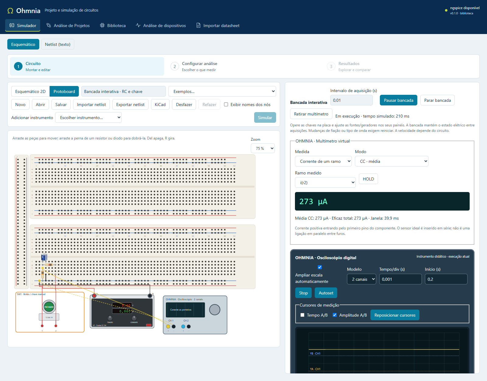

# Bancada interativa — primeira etapa

## O que está disponível

Em **Simulador → Protoboard**, **Iniciar bancada** abre uma sessão transitória contínua.
O ngspice mantém o mesmo circuito, tempo e estado elétrico entre aquisições: operar uma chave
ou ajustar a fonte não refaz o ponto de operação nem descarrega artificialmente capacitores.
A inicialização usa o ponto de operação CC; para observar a energização, comece com a chave
aberta ou a fonte em zero e opere o controle após iniciar.

- Chaves manuais e botões NA/NF/de quatro pernas: operação na representação da peça.
- Fontes de tensão/corrente e geradores: ajuste de valores, amplitude, offset, frequência e
  duty cycle nos controles existentes. As alterações entram no próximo trecho simulado.
- Osciloscópio de 2/4 canais: lê somente as ponteiras conectadas na miniatura. Escala,
  acoplamento, trigger, Run/Stop e cursores continuam disponíveis. Ativar cursores congela a
  aquisição do osciloscópio, enquanto o circuito e o multímetro continuam funcionando.
- A escala vertical pode se ampliar automaticamente para não perder um sinal que cresceu.
  Ajustar escala/posição manualmente desliga essa ampliação; a caixa permite reativá-la.
- Multímetro opcional em **Adicionar instrumento → Multímetro** ou **Adicionar multímetro**:
  tensão diferencial entre dois furos e corrente de ramos com dois terminais. Corrente positiva
  entra pelo primeiro pino; o sensor ideal de 0 V é inserido em série.
- Leitura CC média, opção instantânea, eficaz total, eficaz CA sem componente CC e HOLD.
  A integração do multímetro respeita os intervalos do passo adaptativo do simulador.

## Como testar

1. Monte um circuito analógico no esquemático e abra **Protoboard**.
2. Use **Montar automaticamente** ou faça as ligações. A montagem deve passar na conferência;
   peças sem pinagem confirmada continuam impedindo a simulação pela protoboard.
3. Adicione um osciloscópio e conecte seus bornes +/− aos furos da placa.
4. Escolha o intervalo de aquisição e clique em **Iniciar bancada**. O tempo mostrado é o
   tempo elétrico simulado. Em telas largas os instrumentos ficam ao lado da placa.
5. Clique na chave e ajuste a fonte/gerador. Observe o efeito no osciloscópio.
6. Adicione o multímetro, selecione os furos de tensão ou o ramo de corrente e experimente
   CC/CA e HOLD.
7. **Pausar bancada** termina o trecho em processamento e conserva o estado para continuar.
   O Stop do osciloscópio congela apenas a tela do instrumento.
8. **Parar bancada** encerra a sessão. Alterar fiação, componentes, análise ou certos tipos
   de fonte exige iniciar uma nova sessão.

Circuito genérico de teste: `frontend/e2e/fixtures/interactive-bench.json`. Tem fonte de 5 V,
chave, resistor de 1 kΩ, capacitor de 1 µF e carga de 10 kΩ. Com a chave fechada a tensão tende
a 4,545 V; com a fonte em 3 V tende a 2,727 V e a corrente da carga a 272,7 µA. São valores
didáticos, sem atribuição a peças reais de fabricante.

## Arquitetura

Cada sessão possui seu próprio processo do ngspice, cuja biblioteca não é reentrante.
É necessária a biblioteca compartilhada (`ngspice.dll`/`libngspice`); o executável em lote
sozinho não oferece este modo de execução contínua.
A API oferece criação (`POST /api/v1/bench`), avanço/controles (`POST /{id}/advance`) e
encerramento (`DELETE /{id}`). As aquisições usam `stop when time`, `alter` e `resume`, conforme
o [manual oficial do ngspice](https://ngspice.sourceforge.io/docs/ngspice-manual.pdf), seções
**Stop**, **Alter** e **Resume** do interpretador interativo.

O navegador solicita novo trecho após receber o anterior. Um clique não inicia uma simulação
comum e não há aquisições simultâneas para a mesma tela. SIN, PULSE e PWL preservam as regras
nativas; mudanças de frequência usam o tempo absoluto. Os instrumentos recebem uma janela
móvel de até 4.000 amostras dos nós de ligação e sensores dos ramos; vetores internos dos
modelos não são enviados à interface.

## Limites desta etapa

- Não há garantia de relação 1:1 entre tempo simulado e relógio real. O painel solicita dados
  aproximadamente a cada 200 ms, além do tempo de cálculo e comunicação.
- O passo máximo é o menor entre intervalo/1.000 e `tmax` transitório informado. SIN/PULSE
  precisam de pelo menos 20 passos por período. Para sinais rápidos, reduza o intervalo ou
  configure `tmax` e reinicie. Há limite de 20.000 passos nominais por aquisição;
  o ngspice pode inserir passos adaptativos adicionais.
- Até duas sessões por servidor, com prazo de 15 s por aquisição. Uma sessão sem comandos
  por 15 minutos é encerrada. Fechar/sair da página solicita encerramento imediato.
- Limite por sessão: 10.000 aquisições, 5 milhões de pontos ou 50 milhões de valores nativos,
  o que ocorrer primeiro. O limite encerra a sessão com mensagem explícita.
- Esta etapa é analógica. Firmware/CLP, sensores digitais, varreduras e diretivas SPICE extras
  continuam no fluxo **Simular**, mas ainda não na bancada contínua.
- Fontes ajustáveis usam números concretos (com os sufixos SPICE), sem expressões `.param`.
- O multímetro é ideal, sem carga de entrada na tensão nem resistência de burden na corrente.
  Corrente é escolhida por ramo, não por ligação livre de duas ponteiras em paralelo.
- Resistência e continuidade ficam para a próxima etapa, conforme o escopo aprovado.

## Validação

- RC contra resposta analítica, com continuidade do tempo e da carga armazenada.
- Chave abrindo/fechando, ajuste de senoide, duty cycle do pulso e PWL repetitiva.
- API com processos reais: isolamento de duas bancadas, liberação ao parar, recusa de
  montagem incompleta e encerramento de sessão com controle inválido.
- Multímetro: CC constante, eficaz CA e integração ponderada em amostragem não uniforme.
- Chrome: chave/fonte, V/A, HOLD, pausa/continuação, sinal visível, cursores, ausência de
  reinício da transitória e instrumentos sem sobrepor a placa.

Teste de navegador: `frontend/e2e/interactive-bench.e2e.cjs`; usa `BASE`, `SHOTS`, `PROJECT`
opcional e `PLAYWRIGHT_CHROMIUM_EXECUTABLE_PATH`. Execute contra um servidor isolado.

Resultados locais finais (25/11/2026):

- Suíte geral: **1.265 aprovados, nenhum reprovado e um teste de OCR pulado** por ausência de
  Tesseract/tessdata configurado no ambiente de testes. Os 11.037 casos `datasheet`, com
  downloads externos, foram desmarcados conforme o padrão do projeto.
- Dez testes específicos da bancada/API aprovados na consolidação final, incluindo os casos
  adicionais de pulso, PWL e fonte de corrente. A PWL é comparada ao valor analítico da rampa
  após a alteração, não apenas à presença de oscilação.
- **Cobertura consolidada: 94,09%**, acima do mínimo de 80%.
- **85 testes do frontend aprovados** em 20 arquivos. Build, ESLint, Prettier, Ruff,
  mypy (197 arquivos de fonte) e os dois contratos de importação aprovados.
- Chrome aprovado, incluindo menu do multímetro, dois/quatro canais, cursores, sinal visível,
  operação dos instrumentos e encerramento da sessão.

A suíte geral foi executada uma vez (2 h 22 min 42 s). Houve um aviso já existente em filtro
ideal, `log10(0)`, sem falha de teste. Após a execução, somente os testes específicos foram
rodados para consolidar a cobertura dos ajustes finais.

